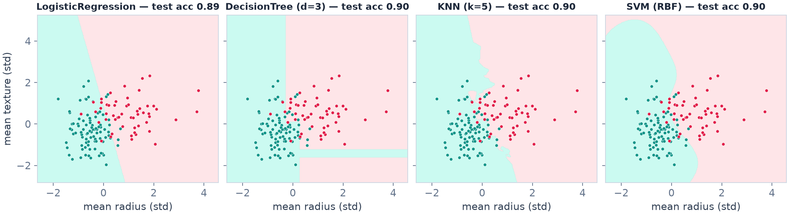
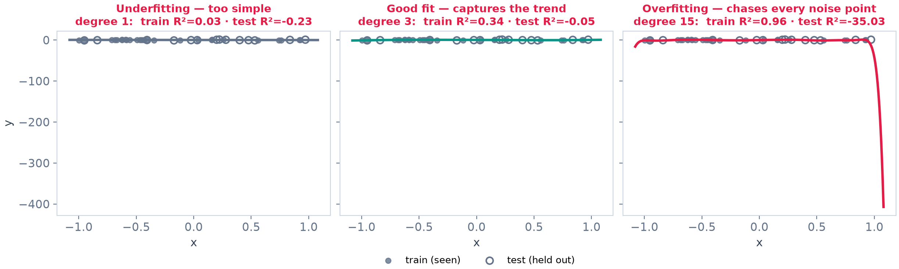
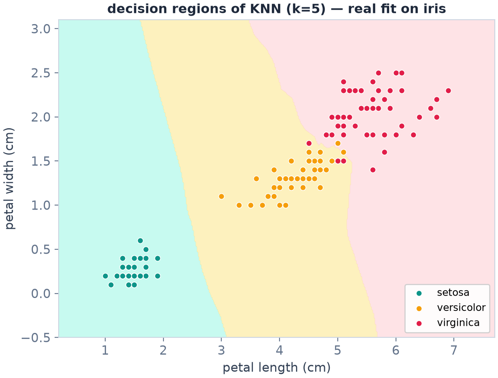
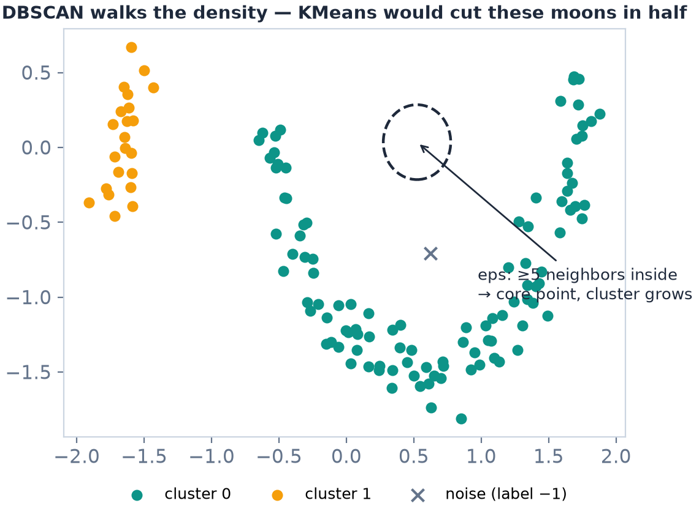

# Machine Learning with scikit-learn


**Instructor:** Shutchon Premchaisawatt
*A master's degree course on applied machine learning — from raw data to an honest, working model.*

คอร์ส Machine Learning เชิงปฏิบัติสำหรับปริญญาโท: สไลด์ภาษาอังกฤษ · แล็บภาษาไทย · รันบน Google Colab ได้ทันที

---

Every concept figure in this course is a **real fit computed from real data** — nothing is hand-drawn.
Example: four classifiers, one dataset, four different geometries.



## ✨ What makes this course different

- **Evaluation before models.** Students learn to measure honestly (train/test splits, cross-validation,
  the right metric) in Session 04 — *before* meeting the model zoo in Sessions 05–06.
- **Every number on every slide is real.** All figures, benchmark tables, and demo code are computed
  and verified with scikit-learn runs (fixed `random_state`), so the slides match the notebook output exactly.
- **Bilingual by design.** English slides + run-along demo notebooks (English headers, Thai explanations)
  + Thai-language labs in Google Colab.
- **AI-assistant ready.** Every lab ends with a *vibe coding corner*: a ready-to-use prompt for AI
  assistants — plus the specific way they tend to fail on that topic, so students learn to verify, not trust.

| | | |
|:---:|:---:|:---:|
|  |  |  |
| under · right · over fit | what KNN really learns | density-based clustering |

## 🚀 Quick start (students)

1. Download a lab notebook from [`excercises/`](excercises/) (or clone this repository)
2. Open [colab.research.google.com](https://colab.research.google.com) → **File → Upload notebook**
3. **File → Save a copy in Drive** so your work is kept
4. Run cells top-to-bottom with `Shift+Enter`

Everything (`scikit-learn`, `pandas`, `seaborn`, `matplotlib`) is pre-installed in Colab —
no setup, no `pip install`. All datasets load automatically.

## 🧭 Course map — 8 sessions + final project

| # | Session (slides) | Demo notebook | Lab (Thai) | Solution |
|---|---|---|---|---|
| 00 | [Course Overview](slides/00%20Course%20Overview.pdf) | [warm-up: Colab + pandas](demos/00.course_warmup_demo.ipynb) | — | — |
| 01 | [Introduction to ML](slides/01%20Introduction%20to%20Machine%20Learning.pdf) | [first model in 5 lines](demos/01.ml_intro_demo.ipynb) | [Lab 01](excercises/01.ml_intro_exercise.ipynb) | [✅](excercises/solutions/01.ml_intro_solution.ipynb) |
| 02 | [Data Understanding & Cleaning](slides/02%20Data%20Understanding%20and%20Cleaning.pdf) | [EDA + cleaning on Titanic](demos/02.data_cleaning_demo.ipynb) | [Lab 02](excercises/02.data_cleaning_exercise.ipynb) | [✅](excercises/solutions/02.data_cleaning_solution.ipynb) |
| 03 | [Feature Engineering & Pipelines](slides/03%20Feature%20Engineering%20and%20Pipelines.pdf) | [the 15-line leak-free template](demos/03.pipeline_demo.ipynb) | [Lab 03](excercises/03.pipeline_exercise.ipynb) | [✅](excercises/solutions/03.pipeline_solution.ipynb) |
| 04 | [Model Evaluation & Cross-Validation](slides/04%20Model%20Evaluation%20and%20Cross-Validation.pdf) | [overfit, holdout lottery, metrics](demos/04.evaluation_cv_demo.ipynb) | [Lab 04](excercises/04.evaluation_cv_exercise.ipynb) | [✅](excercises/solutions/04.evaluation_cv_solution.ipynb) |
| 05 | [Regression Models](slides/05%20Regression%20Models.pdf) | [California housing shootout](demos/05.regression_demo.ipynb) | [Lab 05](excercises/05.regression_exercise.ipynb) | [✅](excercises/solutions/05.regression_solution.ipynb) |
| 06 | [Classification & Ensembles](slides/06%20Classification%20and%20Ensembles.pdf) | [logistic → trees → committees](demos/06.classification_ensembles_demo.ipynb) | [Lab 06](excercises/06.classification_ensembles_exercise.ipynb) | [✅](excercises/solutions/06.classification_ensembles_solution.ipynb) |
| 07 | [Unsupervised + Tuning](slides/07%20Unsupervised%20Learning%20and%20Hyperparameter%20Tuning.pdf) | [wine clusters + PCA + search](demos/07.clustering_tuning_demo.ipynb) | [Lab 07](excercises/07.clustering_tuning_exercise.ipynb) | [✅](excercises/solutions/07.clustering_tuning_solution.ipynb) |
| 08 | [Final Project: Churn](slides/08%20Final%20Project%20Customer%20Churn%20Prediction.pdf) | [instructor walkthrough](demos/08.final_project_demo.ipynb) | [🚀 starter](excercises/08.final_project_starter.ipynb) | [✅](excercises/solutions/08.final_project_solution.ipynb) |

Each session (~2.5–3 h): **slides** (~60 min) → **demo notebook** (same code as the slides, runnable)
→ **lab** (~60 min, Thai, with hints and a challenge problem). Editable `.pptx` sources are in
[`slides/`](slides/) next to the PDFs.

## 📊 Datasets — all load automatically

| Dataset | Used in | Loads via |
|---|---|---|
| Iris, Wine, Breast Cancer, Diabetes | S01, S04, S06, S07 | `sklearn.datasets` (offline) |
| California Housing | S05 | `sklearn.datasets` (auto-download) |
| Titanic | S02, S03 | `seaborn.load_dataset` |
| Telco Customer Churn (7,043 × 19) | S08 project | public IBM GitHub URL (starter includes a synthetic fallback) |

## 🤖 AI-assistant ("vibe coding") policy

AI assistants are allowed **everywhere** — labs and the final project included — with two rules:

1. You must be able to explain every line you submit
2. Attach the prompts you used at the end of your notebook

Every lab's *vibe coding corner* shows a good prompt **and** the failure mode to watch for on that
topic: invented APIs, silent data leakage, or accuracy-worship on imbalanced data.

## 📝 Assessment

| Component | Weight | Notes |
|---|---|---|
| Labs (8) | 40% | completion + honest attempts, not max scores |
| Final project | 40% | clean pipeline · honest evaluation · insight · 5-min talk (rubric in S08) |
| Participation | 20% | running demos along, asking questions |

No points for the highest leaderboard score — points for the cleanest, most honest, most actionable project.

## 📁 Repository layout

```
├── slides/            00–08 as .pptx (editable) + .pdf (distribute)
├── demos/             run-along notebooks for lecture use
├── assets/figures/    matplotlib concept figures embedded in the decks
│                      (overfitting, decision regions, KMeans, DBSCAN, PCA, …)
├── excercises/        Thai lab notebooks (students)
│   └── solutions/     worked solutions (instructors)
├── LICENSE            MIT
└── README.md
```

## 📄 License

Released under the [MIT License](LICENSE) — use, adapt, and redistribute freely for teaching.
